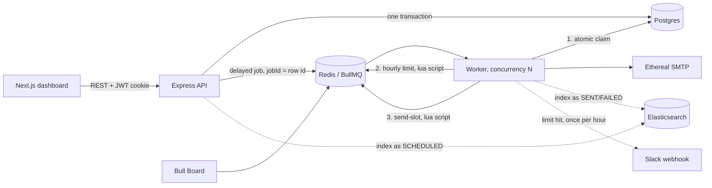
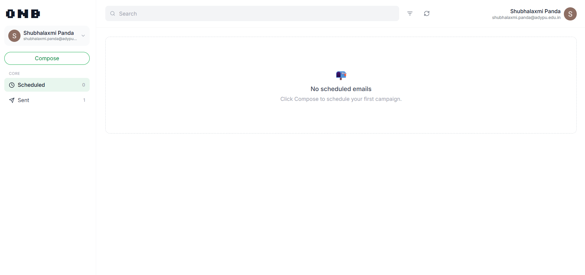
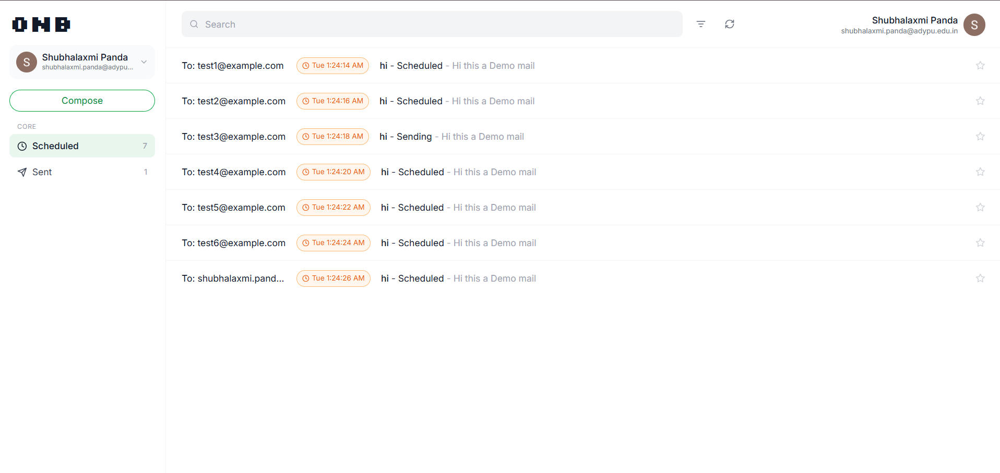
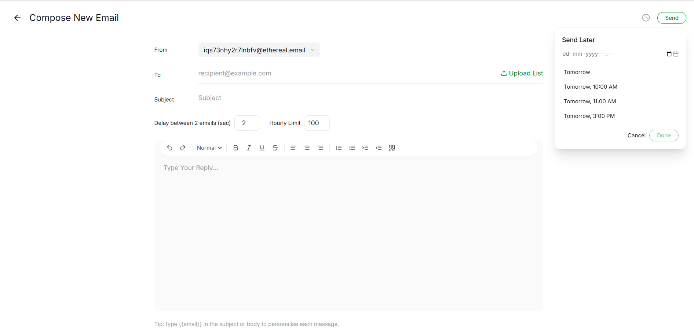
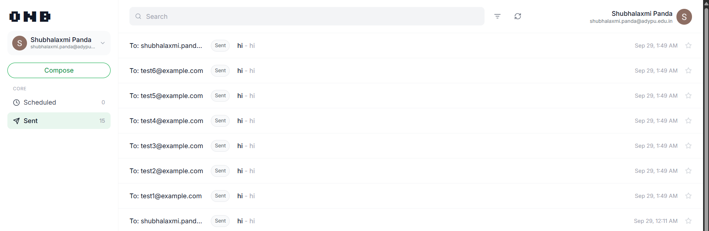

# ReachInbox Email Scheduler

A full-stack email job scheduler built for the Outbox Labs (ReachInbox) SDE Intern take-home assignment. It schedules cold emails at scale, survives restarts without losing or duplicating a job, and enforces per-sender throughput limits.

[View Demo Video](https://drive.google.com/file/d/1Y2198tVWNMmYsbRmj5jSARqmJsIk0WpE/view?usp=sharing)

This is a private repository. Access has been granted to **Mitrajit** and **Yadav036**.

## Contents

1. [The problem](#the-problem)
2. [What I built](#what-i-built)
3. [Tech stack](#tech-stack)
4. [How to run it](#how-to-run-it)
5. [Ethereal Email and environment variables](#ethereal-email-and-environment-variables)
6. [Architecture overview](#architecture-overview)
7. [Features implemented](#features-implemented)
8. [Screenshots](#screenshots)
9. [Demo video](#demo-video)
10. [Testing](#testing)
11. [Bugs I hit and fixed](#bugs-i-hit-and-fixed)
12. [Deployment trade-off](#deployment-trade-off)
13. [Assumptions, shortcuts and trade-offs](#assumptions-shortcuts-and-trade-offs)
14. [What I'd improve with more time](#what-id-improve-with-more-time)

## The problem

Outbox Labs asked for a slice of what ReachInbox does under the hood. The system accepts an email send request through an API, schedules it for a specific time, and delivers it at scale. It has to do this without cron jobs, without losing track of anything if the server goes down, and without letting a sender exceed a provider's hourly limit.

The brief has three parts that make this harder than a basic "send an email later" app:

1. **No cron.** Scheduling uses a real job queue (BullMQ on Redis), not a `setInterval` or a crontab entry.
2. **Restart safety.** If the server is killed mid-send and brought back, every pending email still fires exactly once, at the right time.
3. **Throughput control.** Worker concurrency is configurable, senders have a minimum delay between sends, and each sender has an hourly cap. Overflow is rescheduled rather than dropped, and a Slack alert fires the moment a sender hits its limit.

## What I built

**Backend:** Express and TypeScript, with BullMQ on Redis for scheduling, Postgres (via Prisma) as the source of truth, Ethereal for fake SMTP, Elasticsearch for search, Bull Board for live queue visibility, and real Google and Slack OAuth.

**Frontend:** Next.js (App Router) and Tailwind, built to match the Figma. It has the ONB sidebar, Scheduled and Sent lists with time and status pills, a full-page Compose screen with a rich-text editor and a "Send Later" popover, and a per-email detail view.

Everything is runnable and I tested each requirement myself. The "Bugs I hit and fixed" section covers what broke along the way.

## Tech stack

| Layer | Choice | Why |
|---|---|---|
| Backend language | TypeScript | Required by the brief |
| Framework | Express | Required by the brief |
| Queue | BullMQ on Redis | Delayed jobs with no cron, persisted to disk via Redis AOF |
| Database | Postgres and Prisma | Relational, and Prisma transactions made the "one batch, many rows" write straightforward |
| Email | Nodemailer and Ethereal | Fake SMTP that gives a real preview link per send |
| Search | Elasticsearch | Required by the brief for searchable sent and scheduled emails |
| Queue UI | Bull Board | Live dashboard, mounted behind login |
| Frontend | Next.js and Tailwind | Required by the brief; App Router made the compose, list and detail routes easy to structure |
| Auth | Passport (Google), Slack OAuth v2 | Both required as real flows, not mocks |

## How to run it

**Prerequisites:** Node.js, npm and Docker.

### 1. Start Postgres, Redis (AOF on) and Elasticsearch

```bash
docker compose up -d
```

### 2. Start the backend (Express API and BullMQ worker)

```bash
cd backend
cp .env.example .env                       # fill in Google and Slack credentials, generate two secrets
npm install
npx prisma db push
npm run senders:create -- 3                # prints ETHEREAL_SENDERS=... -> paste into .env
npm run dev                                # API on :4000
npm run worker                             # run in a separate terminal
```

### 3. Start the frontend

```bash
cd frontend
cp .env.example .env.local
npm install
npm run dev                                # http://localhost:3000
```

### 4. Open the app

| What | URL |
|---|---|
| App | http://localhost:3000 |
| API | http://localhost:4000 |
| Live queue dashboard (Bull Board, behind login) | http://localhost:4000/admin/queues |

Use `localhost` consistently and avoid `127.0.0.1`. Cookies match on the exact host name, so mixing the two breaks login on refresh.

## Ethereal Email and environment variables

### Ethereal

[Ethereal](https://ethereal.email) is a fake SMTP service. It accepts mail without delivering it and gives each message a preview URL. To create senders:

```bash
cd backend
npm run senders:create -- 3
```

The command creates three Ethereal accounts and prints an `ETHEREAL_SENDERS=...` line. Paste that line into `backend/.env`. Having several senders lets you watch per-sender limits work independently.

### Environment variables

All values are configurable and none are hardcoded. The exact names are in `backend/.env.example` and `frontend/.env.example`.

| Area | Purpose |
|---|---|
| Postgres | Connection string used by Prisma |
| Redis | `REDIS_URL`, used by BullMQ and the rate-limiter Lua scripts |
| Elasticsearch | Node URL for the search index |
| `ETHEREAL_SENDERS` | Generated by `npm run senders:create` |
| Google OAuth | Client ID and secret, with redirect `http://localhost:4000/api/auth/google/callback` |
| Slack OAuth | Client ID and secret, with redirect `http://localhost:4000/api/slack/callback` |
| Secrets | Two generated secrets |
| Throughput | Minimum delay per sender (default 2 seconds), hourly limit per sender (default 100), worker concurrency (default 5) |

**Google OAuth:** create an OAuth client in Google Cloud Console, add the redirect URI above, and configure the consent screen.

**Slack:** create a Slack app, turn on Incoming Webhooks, add the `incoming-webhook` and `chat:write` bot scopes, and set the redirect URI above.

## Architecture overview



### How scheduling works

A schedule request writes one `EmailBatch` and N `ScheduledEmail` rows in a single Postgres transaction. It then adds N BullMQ delayed jobs, one per recipient, with `delay = scheduledAt - now` and `jobId` set to the row's own id. No cron job exists anywhere. Redis holds the delay and hands the job to a worker when it is due.

### How persistence on restart is handled

"Don't lose jobs" and "don't duplicate jobs" pull in opposite directions, so four mechanisms work together:

1. **Redis AOF** is on in `docker-compose.yml`, so a delayed job survives a container restart as well as a process restart.
2. **The database row is the source of truth.** Every job starts with one atomic `UPDATE ... WHERE status IN (SCHEDULED, RATE_LIMITED_REQUEUED)`. If BullMQ redelivers a job after a crash, the row is already `PROCESSING` or `SENT`, the update matches nothing, and the job does nothing.
3. **A stale claim can be retaken.** If a worker dies mid-send, its `PROCESSING` claim expires after 2 minutes and another worker can pick the row back up.
4. **Boot-time recovery.** When the worker starts, `recoverOrphanedSchedules()` looks for any unfinished row with no matching BullMQ job and re-enqueues it. This only happens if Redis was wiped independently of Postgres.

### How rate limiting and concurrency are implemented

**Concurrency** is set on the BullMQ worker (default 5).

**Rate limiting** covers both the hourly cap and the minimum delay, and both run as small Lua scripts in Redis rather than as in-memory counters. An in-memory counter goes wrong as soon as more than one worker process runs, because each process counts independently. A Lua script makes "check the count, then increment it" one atomic operation, so the result is correct for any number of workers.

- **Hourly limit:** a key such as `ratelimit:{sender}:{2026-09-29T14}` is incremented only while it is under the limit. A rejected call never inflates the counter.
- **Minimum delay:** a key reserves the next allowed send timestamp for that sender, so concurrent jobs for the same sender line up `gap` milliseconds apart instead of racing.
- **Overflow:** the job is never dropped or failed. `job.moveToDelayed` moves it to the start of the next hour window, and a rank counter keeps requeued jobs in roughly their original order.
- **Slack alert:** one alert is sent per sender per hour window, using a separate `claimSlackAlert` key where the first caller wins. It does nothing if the user hasn't connected Slack.

Default values, all set through env variables: a 2 second minimum delay per sender, 100 emails per hour per sender (the Compose form can override this per batch), and worker concurrency of 5.

## Features implemented

### Backend

| Area | Implemented |
|---|---|
| Scheduler | API-based scheduling stored in Postgres, BullMQ delayed jobs with no cron, multiple senders via Ethereal |
| Persistence | Redis AOF, atomic database claim, stale-claim retake, boot-time orphan recovery, no duplicate sends |
| Rate limiting | Hourly cap per sender in Redis and Lua, safe across multiple workers, overflow rescheduled rather than dropped |
| Delay | Minimum 2 second gap between sends per sender, configurable and overridable per batch |
| Concurrency | Configurable worker concurrency (default 5) |
| Search | Scheduled and sent emails searchable through Elasticsearch |
| Observability | Bull Board live dashboard behind login |
| Alerts | Slack OAuth and a live alert when a sender hits its limit |
| Auth | Google OAuth through Passport |

### Frontend

| Area | Implemented |
|---|---|
| Login | Google OAuth, header with name, email and avatar, logout |
| Dashboard | ONB sidebar, Scheduled and Sent lists with time and status pills |
| Compose | Subject, rich-text body, CSV upload with detected recipient count, start time, delay, hourly limit, "Send Later" popover |
| Tables | Scheduled and Sent tables with loading and empty states |
| Detail view | Per-email detail page |
| Code quality | Reusable components and typed API responses |

## Screenshots

| Dashboard | Scheduled List | Compose |
|---|---|---|
|  |  |  |

| Sent List | Ethereal Preview | Bull Dashboard |
|---|---|---|
|  |  |  |

## Demo video

[View Demo Video](https://drive.google.com/file/d/1Y2198tVWNMmYsbRmj5jSARqmJsIk0WpE/view?usp=sharing)

The video shows:

1. Creating scheduled emails from the frontend.
2. The dashboard with Scheduled and Sent emails.
3. A restart scenario: stopping the server, starting it again, and the future emails still sending.
4. Rate limiting and delay behavior under load.

## Testing

```bash
npm run typecheck        # backend and frontend both
npm test                 # lead parsing, html sanitizer, preview text
REDIS_URL=redis://localhost:6379 npm test   # + integration: rate limiter under 50 parallel calls,
                                             #   send spacing, one Slack alert, restart-survives-and-runs-once
npm run loadtest -- you@gmail.com 1000 50   # schedules 1000 emails at once with a limit of 50/hour
```

## Bugs I hit and fixed

- **The rate-limit requeue crashed the worker.** My first version tried to remove the running BullMQ job and re-add it, but a job can't remove itself mid-execution. I switched to `job.moveToDelayed()`, which is built for this case.
- **The Compose form's delay and hourly limit were ignored.** The worker read only the env defaults, so a stricter limit set in the UI had no effect. The worker now reads `batch.hourlyLimit` and `batch.delayMs`.
- **Two workers side by side could send the same email twice.** Both read the row as `SCHEDULED` and both tried to send it. The atomic `UPDATE ... WHERE status IN (...)` claim fixed this.
- **Slack reported "Email Assignment doesn't have a bot user to install."** This happens when Incoming Webhooks is enabled but no Bot Token Scope has been added. Adding `incoming-webhook` and `chat:write` under OAuth & Permissions creates the bot user.
- **Login worked, then failed on refresh.** I was testing the frontend on `127.0.0.1` while the API cookie was set for `localhost`, and cookies don't share across host names.
- **Elasticsearch threw on the first API request** when it hadn't finished booting, since it starts more slowly than Postgres or Redis. Index setup now retries a few times on boot.

## Deployment trade-off

This project is not deployed to a public cloud. I chose to spend my limited time on what the brief tests most directly (correctness, restart safety, rate limiting and the UI) and to show it working in a recorded demo.

A quick deploy isn't realistic here because the system is not a single web app. It is five cooperating services, and most of them hold state.

| Reason | Why it slows a deploy |
|---|---|
| Persistent Redis | Delayed jobs must survive restarts, so Redis needs AOF on durable disk. Many free or serverless Redis tiers don't offer that, and per-command billing gets costly with BullMQ's constant polling. |
| Separate long-running worker | The BullMQ worker is a persistent process, not a request handler. Serverless platforms can't host it, so it needs an always-on container. |
| Elasticsearch memory | It typically needs around 1 to 2 GB of RAM, which free tiers rarely provide and managed clusters charge for. |
| Postgres | It needs a managed instance, connection pooling for Prisma, and a migration step in the release process. |
| OAuth tied to localhost | The Google and Slack redirect URIs and webhook scopes are registered against `localhost`. A public URL means registering both apps again, and Google may require app verification for external users. |
| Cross-site cookies | A frontend and API on different domains need `SameSite=None; Secure` cookies, HTTPS and CORS changes. I already hit one cookie-host bug locally. |
| Secrets and cost | Five services means provisioning and storing secrets in several places, plus a monthly bill. |
| The restart demo | Stopping and starting the server is easier to show reliably on a machine I control than on a shared cloud host. |

Ethereal is a fake SMTP sandbox, so a public deployment would not deliver real mail either. A hosted URL would add setup risk without showing anything the demo doesn't.

The whole stack starts with `docker compose up -d`, and every setting comes from env variables, so a reviewer can reproduce it locally.

With more time, I would deploy it like this:

| Component | Target |
|---|---|
| Frontend | Vercel |
| API and worker | Two always-on containers (Railway, Render or Fly.io) |
| Postgres | Managed Postgres (Neon or Supabase) |
| Redis | Managed Redis with AOF persistence |
| Elasticsearch | Small managed cluster (Elastic Cloud or Bonsai) |
| Auth | New production OAuth redirect URIs and HTTPS cookies |

## Assumptions, shortcuts and trade-offs

| Decision | Reasoning |
|---|---|
| Runs locally through Docker Compose, not deployed | See [Deployment trade-off](#deployment-trade-off). I put correctness ahead of hosting. |
| Ethereal instead of a real SMTP provider | It is free, safe, and gives a preview link per send. No real mail can go out. |
| Fixed clock-hour rate-limit buckets | They are simple, atomic and easy to verify. A sliding window is the next step. |
| One Elasticsearch index created on boot | Enough for search. Index lifecycle management is out of scope. |
| Email and password fields on the login screen are disabled | They match the Figma, but the brief requires Google OAuth only. |
| "Send Later" sets the batch start time | Clicking Send with no time picked starts immediately. |
| The star icon on list rows is a local UI toggle | It isn't persisted to the database. |
| No attachments in Compose | The Figma shows them and the brief doesn't require them, so I left them out instead of half-building them. |
| Layout, components and colors matched from Figma screenshots | I didn't have edit access to pull exact spacing tokens from dev mode. |
| Tests run locally with no CI | Typecheck and tests run before each commit. |

## What I'd improve with more time

- **A sliding-window rate limiter** in place of clock-hour buckets. The counter currently resets exactly on the hour, so a sender could use its full quota at 12:59 and again at 1:00, doubling up for one minute. A Redis sorted set keyed by timestamp would fix this.
- **Elasticsearch index lifecycle management** and a backfill job, instead of a single index created on boot.
- **Pixel-exact Figma matching** using spacing tokens from dev mode.
- **Attachments in Compose.**
- **A CI pipeline** (GitHub Actions running typecheck and tests on every push).
- **A cloud deployment** following the plan above.
