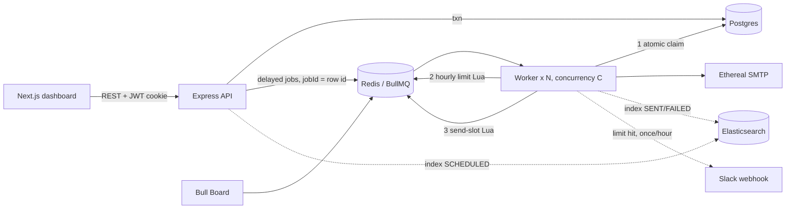

# ReachInbox Email Scheduler

Production-minded email scheduler + dashboard: **Express + TypeScript, BullMQ/Redis, Postgres (Prisma), Ethereal SMTP,
Elasticsearch, Bull Board, Google & Slack OAuth, Next.js + Tailwind.** Scheduling uses BullMQ delayed jobs only: **no cron anywhere.**

## Requirement checklist

| Requirement | Status | Where |
|---|---|---|
| Accept send requests via API, store in SQL | ✅ | `routes/emails.ts` (`POST /api/emails/schedule`, Prisma + Postgres, one transaction) |
| BullMQ delayed jobs, no cron | ✅ | `queue/emailQueue.ts` |
| Multiple senders via Ethereal | ✅ | `services/mailer.ts`, `ETHEREAL_SENDERS`, `npm run senders:create` |
| Elasticsearch: scheduled **and** sent searchable | ✅ | indexed on schedule + updated on send/fail; per-user filtered (`services/search.ts`) |
| Live BullMQ dashboard | ✅ | Bull Board at `/admin/queues` (behind login) |
| Survives restarts, no duplicates, no restart-from-scratch | ✅ | Redis AOF + atomic DB claim + boot recovery + integration test |
| Configurable worker concurrency | ✅ | `WORKER_CONCURRENCY` |
| Min delay between sends | ✅ | per sender, atomic Redis slot reservation, `max(MIN_DELAY_MS_BETWEEN_SENDS, batch delay)` |
| Hourly limit, Redis-backed, multi-worker safe | ✅ | Lua script in `queue/rateLimiter.ts`, per sender, per batch limit (UI) with env default |
| At limit: never drop/fail, roll to next hour, keep order | ✅ | `job.moveToDelayed` + per-window rank |
| Slack OAuth + live message on limit hit | ✅ | `services/slack.ts`; once per sender per window; no-op if disconnected; works after later connect |
| Behaviour under 1000+ emails | ✅ | `npm run loadtest -- you@gmail.com 1000 50` |
| No duplicates / idempotency | ✅ | 3 layers (below) |
| Google login, header name/email/avatar, logout | ✅ | `routes/auth.ts`, `Header.tsx` |
| Dashboard tabs, Compose, CSV count, start/delay/limit | ✅ | `dashboard/page.tsx`, `ComposeModal.tsx` |
| Loading + empty states, toasts, error handling | ✅ | skeleton rows, empty states, `Toast.tsx` |

## Chosen throughput settings (as required by the brief)

| Setting | Value | Env var |
|---|---|---|
| **Minimum delay between sends** | **2 seconds per sender** (floor; the Compose form can raise it per batch) | `MIN_DELAY_MS_BETWEEN_SENDS=2000` |
| **Emails per hour** | **100 per sender** (default; overridable per batch in the UI) | `MAX_EMAILS_PER_HOUR_PER_SENDER=100` |
| **Worker concurrency** | **5** parallel jobs per worker process | `WORKER_CONCURRENCY=5` |

I chose the **per-sender** hourly option (not global) because the brief requires multiple senders. Nothing is hardcoded: values come from env, with the UI able to override the hourly limit and delay per batch.

## Features by area

**Backend:** scheduler (BullMQ delayed jobs, no cron) · persistence (Postgres + Redis AOF + boot recovery) · rate limiting (Redis Lua, per sender/hour) · concurrency (configurable, atomic shared state) · idempotency (3 layers) · multi-sender Ethereal SMTP · Elasticsearch indexing/search · Bull Board · Slack OAuth + live alerts · Google OAuth · zod validation, helmet, graceful shutdown.

**Frontend (built to the provided Figma):** Google login screen · sidebar (ONB logo, user card, Compose, CORE > Scheduled/Sent with live counts) · top bar (search via Elasticsearch, status filter, refresh, user name/email/avatar + logout) · Scheduled and Sent lists with time/status pills, skeleton loading and empty states · full-page email view (sandboxed HTML) · full-page **Compose** (From, To chips + "+N", **Upload List** CSV/text with detected count, Subject, Delay, Hourly limit, rich-text editor, **Send Later** popover, confirm-and-Schedule modal) · toasts and error handling · Slack connect/test/disconnect · reusable `Button`, `Modal`, `Avatar`, `EmailList`, `RichTextEditor`, `RecipientInput`, `SendLaterPopover`, `Toast`.

## Figma mapping

| Figma frame | Route | Component |
|---|---|---|
| Login Screen | `/login` | `app/login/page.tsx` (real Google OAuth) |
| Homepage: Scheduled | `/dashboard/scheduled` | `EmailListPage` + `Sidebar` + `TopBar` |
| Homepage: Sent | `/dashboard/sent` | same, `kind="sent"` |
| Email view | `/dashboard/email/[id]` | `email/[id]/page.tsx` |
| Compose New Email + Send Later | `/dashboard/compose` | `compose/page.tsx`, `SendLaterPopover` |

## Submission checklist
- [ ] Private GitHub repo, access granted to **Mitrajit** and **Yadav036**
- [ ] Demo video (max 5 min) linked
- [ ] ClickUp form filled with repo + video links

## Architecture



### How scheduling works
`POST /schedule` validates (zod), writes one `EmailBatch` + N `ScheduledEmail` rows in **one transaction**, then bulk-adds
BullMQ delayed jobs (`delay = scheduledAt - now`, `jobId = row id`). Recipient *i* is scheduled at `start + i * delay`.

### How persistence on restart works
1. Jobs live in Redis with AOF enabled, so they survive process *and* container restarts.
2. The row is the source of truth. The worker starts every job with one atomic `UPDATE ... WHERE status IN (SCHEDULED, RATE_LIMITED_REQUEUED)`.
   Already-SENT or in-flight rows match nothing, so redelivery is a no-op. A claim older than 2 minutes (crashed worker) can be re-taken.
3. On boot, `recoverOrphanedSchedules()` re-enqueues unfinished rows that have no job (Redis wiped, or API crashed between commit and enqueue).
4. SIGTERM closes the worker gracefully; unfinished jobs stay in Redis.

### Idempotency (three layers)
- **Submit:** client `idempotencyKey` (unique) makes a double-click or retry return the original batch.
- **Enqueue:** `jobId = row id`, so BullMQ ignores duplicate adds.
- **Execute:** the atomic claim above, plus `FAILED` is only shown after the final retry.

### Rate limiting & concurrency
- **Concurrency:** `WORKER_CONCURRENCY`. Safe because each job owns exactly one row and all shared state is atomic Redis Lua.
- **Hourly limit:** `ratelimit:{sender}:{hour}`, a Lua "increment only if under limit". Rejected calls never inflate the counter, and it is correct across any number of workers/instances.
- **Min delay:** a Lua script hands out send slots exactly `gap` ms apart per sender, so parallel jobs can't burst.
- **At the limit:** the job is moved (not dropped, not failed) to the next hour boundary + `rank*10ms`, preserving order; Slack fires once per sender per window.
- **1000+ at once:** 1000 delayed jobs become due together; concurrency, slot spacing and the hourly counter throttle them, and overflow rolls into later windows automatically.
- **Trade-offs:** fixed clock-hour buckets (not a sliding window); limits are per sender (the counter is shared if two batches use one sender, with the stricter limit winning at that moment).
- **Known at-least-once edge:** if a worker dies *after* SMTP accepts but *before* the DB write, the stale-claim rule may resend once. True exactly-once across SMTP + DB is impossible without provider-side idempotency keys.

## Run it

```bash
docker compose up -d                       # Postgres, Redis (AOF), Elasticsearch
cd backend && cp .env.example .env         # then fill in values
npm install && npx prisma db push
npm run senders:create -- 3                # prints ETHEREAL_SENDERS=... -> paste into .env
npm run dev                                # API :4000
npm run worker                             # separate terminal
cd ../frontend && cp .env.example .env.local && npm install && npm run dev   # :3000
```
Full containers instead: `docker compose --profile app up --build`.

**Google OAuth:** Google Cloud Console -> OAuth client (Web). Redirect URI: `http://localhost:4000/api/auth/google/callback`.
**Slack:** api.slack.com/apps -> create app -> OAuth & Permissions -> redirect `http://localhost:4000/api/slack/callback`, scope `incoming-webhook`, enable Incoming Webhooks.

## Tests
`npm run typecheck` · `npm test` (unit: lead parsing, sanitizer, previews) · `REDIS_URL=redis://localhost:6379 npm test` (integration: 50 parallel limiter calls admit exactly the limit, send spacing,
Slack-once, and a delayed job that survives a worker restart and runs exactly once).

## Demo script (under 5 min)
1. Log in with Google; Compose a 10-lead CSV, start in 1 min, 5s delay -> Scheduled tab.
2. Open Bull Board: delayed jobs. **Kill the worker, restart it**: jobs still fire on time, no duplicates.
3. Sent tab: open an Ethereal "preview" link (proof of real SMTP). Search a subject (Elasticsearch).
4. Set hourly limit 3 -> Slack alert arrives live; jobs show `RATE LIMITED REQUEUED` and roll to next hour.
5. `npm run loadtest -- you@gmail.com 1000 50` to show behaviour under load.

## Assumptions / shortcuts (honest list)
- **Login:** the Figma shows an email/password form; the brief requires Google OAuth only, so those fields are rendered (to match the design) but disabled.
- **Attachments:** the Figma shows image attachments; the brief does not require them, so they are not implemented.
- **Send Later** = the batch start time; the Figma "Send" button (no time chosen) starts immediately.
- **Star** in the list is a local UI toggle (not persisted).
- Elasticsearch: real indexing + fuzzy per-user search; no ILM/backfill job.
- Rich-text body is HTML from a contentEditable editor (`execCommand`); the API sanitizes it (`sanitize-html`) before storing, and the email view renders it in a script-less sandboxed iframe.
- Fixed clock-hour rate-limit buckets (not a sliding window).
- Pixel-level match to Figma was done from screenshots of the frames (layout, colors, components), not from Figma's dev-mode measurements.
