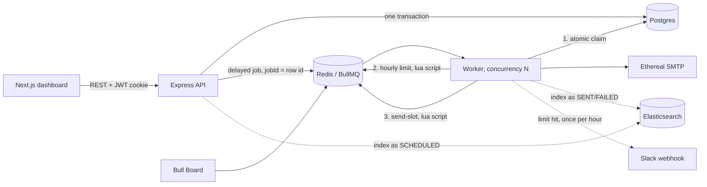

# ReachInbox Email Scheduler

A full-stack email job scheduler built for the Outbox Labs (ReachInbox) SDE Intern take-home assignment. It schedules cold emails at scale, survives restarts without losing or duplicating a single job, and enforces per-sender throughput limits the way a real sending infrastructure has to.

**Live queue dashboard:** `http://localhost:4000/admin/queues` (after you run it locally)
**Demo video:** `<add your link here before submitting>`

---

## The problem

Outbox Labs asked for a slice of what ReachInbox does under the hood: accept an email send request through an API, schedule it for a specific time, and actually deliver it, at scale, without cron jobs, without losing track of anything if the server goes down, and without a sender blowing past a provider's hourly send limit.

The brief had three parts that make this harder than a basic "send an email later" app:

1. **No cron.** Scheduling has to be a real job queue (BullMQ + Redis), not a `setInterval` or a crontab entry.
2. **Restart safety.** Kill the server mid-send, bring it back, and every pending email still fires exactly once, at the right time.
3. **Throughput control.** Configurable worker concurrency, a minimum delay between sends, and a per-sender hourly cap that reschedules (not drops) overflow, with a live Slack alert the moment a sender hits its limit.

## What I built

**Backend:** Express + TypeScript, BullMQ on Redis for scheduling, Postgres (via Prisma) as the source of truth, Ethereal for fake SMTP, Elasticsearch for search, Bull Board for live queue visibility, and real Google + Slack OAuth.

**Frontend:** Next.js (App Router) + Tailwind, built to match the Figma: the ONB sidebar, the Scheduled/Sent list with time and status pills, a full-page Compose screen with a rich-text editor and a "Send Later" popover, and a per-email detail view.

Everything below is real and runnable, not a mockup. I've tested each requirement myself; the "bugs I hit" section further down covers what actually broke while I was building it.

## Tech stack

| Layer | Choice | Why |
|---|---|---|
| Backend language | TypeScript | required by the brief |
| Framework | Express | required by the brief |
| Queue | BullMQ on Redis | delayed jobs, no cron, and it persists to disk via Redis AOF |
| Database | Postgres + Prisma | relational, and Prisma's transactions made the "one batch, many rows" write straightforward |
| Email | Nodemailer + Ethereal | fake SMTP, gives a real preview link per send |
| Search | Elasticsearch | required by the brief for searchable sent/scheduled emails |
| Queue UI | Bull Board | live dashboard, mounted behind login |
| Frontend | Next.js + Tailwind | required by the brief; App Router made the compose/list/detail routes easy to structure |
| Auth | Passport (Google), Slack OAuth v2 | both required as real flows, not mocks |

## Architecture



A schedule request writes one `EmailBatch` and N `ScheduledEmail` rows in a single Postgres transaction, then adds N BullMQ delayed jobs, one per recipient, with `delay = scheduledAt - now` and `jobId = the row's own id`. Nothing is a cron job anywhere; Redis just holds the delay and hands the job back to a worker when it's due.

### How restart safety actually works

This was the part of the brief I spent the most time getting right, because "don't lose jobs" and "don't duplicate jobs" pull in opposite directions.

1. **Redis AOF is on** in `docker-compose.yml`, so a delayed job survives a container restart, not just a process restart.
2. **The database row is the real source of truth.** Every job starts with one atomic `UPDATE ... WHERE status IN (SCHEDULED, RATE_LIMITED_REQUEUED)`. If a job gets redelivered by BullMQ after a crash, the row is already `PROCESSING` or `SENT`, the update matches nothing, and the job is a no-op.
3. **A stale claim can be retaken.** If a worker dies mid-send, its `PROCESSING` claim expires after 2 minutes and another worker can pick the row back up.
4. **Boot-time recovery.** On worker start, `recoverOrphanedSchedules()` looks for any unfinished row with no matching BullMQ job (this can only happen if Redis was wiped independently of Postgres) and re-enqueues it.

### How the rate limiter works

Both the hourly cap and the minimum delay between sends are enforced with small Lua scripts run through Redis, not with in-memory counters. I did it this way on purpose: an in-memory counter is wrong the moment you run more than one worker process, because each process would count independently. The Lua script makes "check the count, then increment it" a single atomic operation, so it's correct no matter how many workers are running.

- **Hourly limit:** a key like `ratelimit:{sender}:{2026-09-29T14}`, incremented only if it's still under the limit. A rejected call never inflates the counter.
- **Min delay:** a key that reserves the next allowed send timestamp for that sender, so concurrent jobs for the same sender queue up `gap` milliseconds apart instead of racing.
- **On overflow:** the job isn't dropped or failed. It's moved to the start of the next hour window (`job.moveToDelayed`), and a rank counter keeps requeued jobs in roughly their original order.
- **Slack:** one alert per sender per hour window (a separate `claimSlackAlert` key, first caller wins), and it silently does nothing if the user hasn't connected Slack.

Chosen values, all env-configurable, none hardcoded: **2 second minimum delay per sender**, **100 emails/hour per sender** (the Compose form can override this per batch), **worker concurrency 5**.

## Requirement checklist

| Requirement | Status |
|---|---|
| API-based scheduling, stored in Postgres | done |
| BullMQ delayed jobs, no cron | done |
| Multiple senders via Ethereal | done |
| Scheduled + sent emails searchable via Elasticsearch | done |
| Live Bull Board dashboard | done, behind login |
| Restart-safe, no duplicates | done, see above |
| Configurable concurrency | done |
| Minimum delay between sends | done, 2s per sender |
| Hourly limit, Redis-backed, multi-worker safe | done |
| Overflow rescheduled, not dropped | done |
| Slack OAuth + live alert on limit hit | done |
| Google OAuth, header with name/email/avatar, logout | done |
| Compose: subject, body, CSV upload with detected count, start time, delay, hourly limit | done |
| Scheduled/Sent tables with loading and empty states | done |
| Reusable components, typed API responses | done |

## Screenshots


| Dashboard | Scheduled list | Compose | Sent List | Ethereal Preview | Bull Dashboard |
|---|---|---|---|---|---|
| `add screenshot` | `add screenshot` | `add screenshot` | 'add screenshot' | 'add sc' | 'add sc' |

## How to run it

```bash
docker compose up -d                       # postgres, redis (aof on), elasticsearch

cd backend
cp .env.example .env                       # fill in google/slack creds, generate two secrets
npm install
npx prisma db push
npm run senders:create -- 3                # prints ETHEREAL_SENDERS=... -> paste into .env
npm run dev                                # api on :4000
npm run worker                             # separate terminal

cd ../frontend
cp .env.example .env.local
npm install
npm run dev                                # :3000
```

Full step-by-step setup for Google OAuth and Slack OAuth (redirect URIs, scopes, consent screen, the exact env vars) is in the earlier setup notes; the short version is: create an OAuth client in Google Cloud Console with redirect `http://localhost:4000/api/auth/google/callback`, and a Slack app with Incoming Webhooks on, `incoming-webhook` + `chat:write` bot scopes, and redirect `http://localhost:4000/api/slack/callback`. Bull Board is at `/admin/queues`, behind login.

## Testing it

```bash
npm run typecheck        # backend and frontend both
npm test                 # lead parsing, html sanitizer, preview text
REDIS_URL=redis://localhost:6379 npm test   # + integration: rate limiter under 50 parallel calls,
                                             #   send spacing, one Slack alert, restart-survives-and-runs-once
npm run loadtest -- you@gmail.com 1000 50   # schedules 1000 emails at once with a limit of 50/hour
```

## Bugs I hit and fixed


- **The rate-limit requeue crashed the worker.** My first version tried to remove the currently-running BullMQ job and re-add it. BullMQ doesn't allow that; a job can't remove itself mid-execution. Fixed by switching to `job.moveToDelayed()`, which is built for exactly this.
- **The Compose form's own delay and hourly limit were silently ignored.** The worker only read the env defaults, so a stricter limit set in the UI did nothing. Fixed by reading `batch.hourlyLimit` and `batch.delayMs` inside the worker instead of the env values directly.
- **Two workers running side by side could send the same email twice**, briefly, before I added the atomic `UPDATE ... WHERE status IN (...)` claim. Before that fix, both workers would read the row as `SCHEDULED`, and both would try to send it.
- **Slack said "Email Assignment doesn't have a bot user to install."** This happens when you enable Incoming Webhooks but never add a Bot Token Scope. Fixed by adding `incoming-webhook` and `chat:write` under OAuth & Permissions, which is what actually creates the bot user.
- **Login worked, then silently failed on a refresh.** Caused by testing the frontend on `127.0.0.1` while the API cookie was set for `localhost`. Cookies are exact-match on host name; they don't share.
- **Elasticsearch would throw on the very first API request** if it hadn't finished booting yet, since Elasticsearch takes longer to start than Postgres or Redis. Fixed by retrying index setup a few times on boot instead of failing immediately.

## What I'd improve with more time

- **A sliding-window rate limiter** instead of fixed clock-hour buckets. Right now the counter resets exactly on the hour, so a sender could send its full hourly quota at 12:59 and again at 1:00, effectively doubling up for one minute. A Redis sorted set keyed by timestamp would fix this properly.
- **Real Elasticsearch index lifecycle management** and a backfill job, instead of a single index created on boot.
- **Pixel-exact Figma matching.** I matched layout, components, and color from the provided screenshots; I didn't have edit access to pull exact spacing tokens from Figma's dev mode.
- **Attachments in Compose.** The Figma shows them; the brief doesn't require them, so I left them out rather than half-build them.
- **A proper CI pipeline** (GitHub Actions running typecheck + tests on every push) instead of running them locally before each commit.

## Assumptions

- Email/password fields appear on the login screen to match the Figma, but are disabled: the brief requires Google OAuth only.
- "Send Later" sets the batch's start time; clicking Send with no time picked starts immediately.
- The star icon on list rows is a local UI toggle, not persisted to the database.


